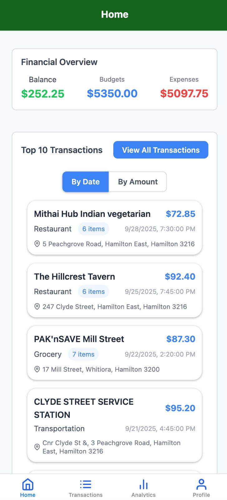
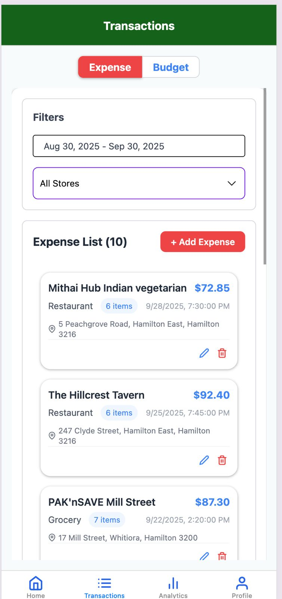
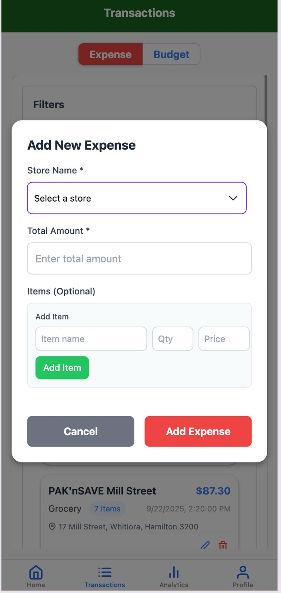
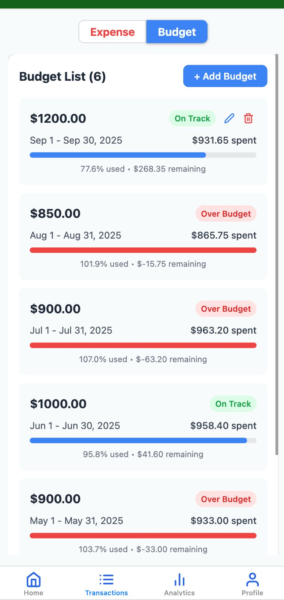
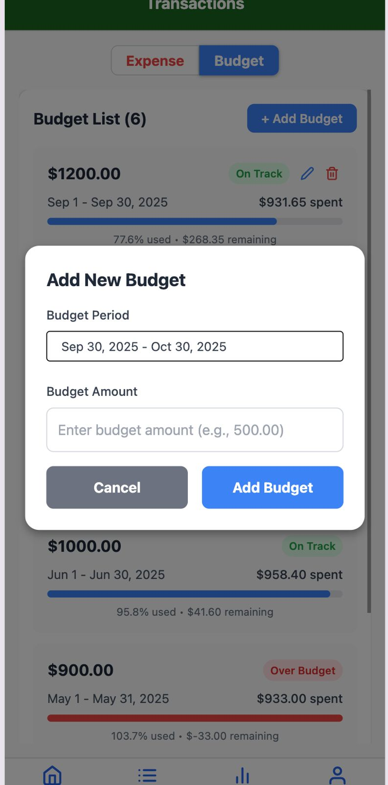
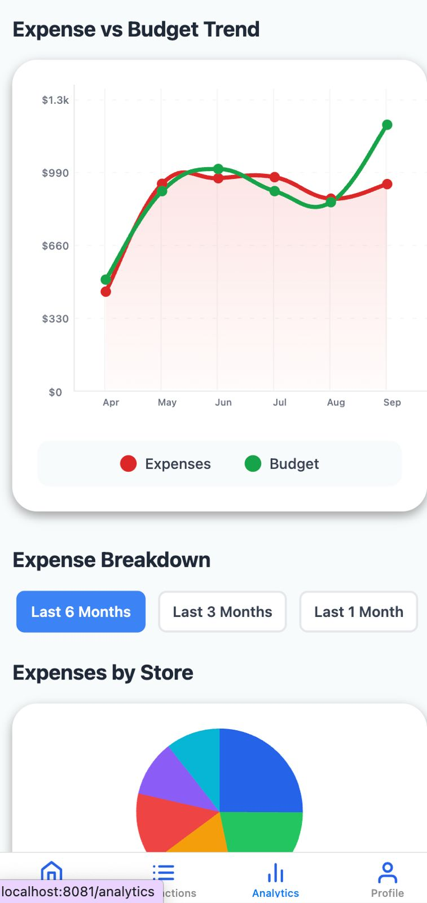

# Personal Finance Tracker – Full Featured

Complete Expo (React Native) frontend + Spring Boot Java backend matching the app screenshots.

## Features Added
- Add / Edit / Delete Expenses (with multi-item support)
- Add Budgets
- Real Line Chart (Expense vs Budget trend) and Pie Chart (by store) via `react-native-chart-kit`
- Sorting (By Date / By Amount)
- Store list endpoint
- Full CRUD on both sides
- Sample data matching Hamilton stores and amounts

## How to Use – App Demo

### Home Screen
View your financial overview (Balance, Budgets, Expenses) and the top 10 recent transactions. Switch sorting between **By Date** and **By Amount**.



### Transactions
Browse the full expense list with filters. Tap **+ Add Expense** to create a new entry, or use the edit/delete icons on each card.



### Add / Edit Expense
Select a store, enter the total amount, and optionally add individual items (name, quantity, price).



### Budgets
See monthly budgets with progress bars, “On Track” / “Over Budget” status, and remaining amounts.



### Add Budget
Create a new budget by setting the period and amount.



### Analytics
Visualise spending with an **Expense vs Budget** trend line chart and an **Expenses by Store** pie chart. Switch time ranges (Last 6 / 3 / 1 Month).



## Backend
```bash
cd backend
mvn spring-boot:run
```
Runs on http://localhost:8081  
H2 console: http://localhost:8081/h2-console (jdbc:h2:mem:financedb)

## Frontend
```bash
cd frontend
npm install
npx expo start
```

**Note:** Change `API_BASE` in screen files to your machine’s IP (e.g. `http://192.168.1.x:8081/api`) when testing on a physical device.

## Structure
- `backend/` – Spring Boot 3, JPA, H2, full REST API
- `frontend/` – Expo app with bottom tabs, modals, charts
- `docs/screenshots/` – Demo images of the application UI

This project demonstrates rapid learning of Expo/React Native alongside a solid Java backend.
